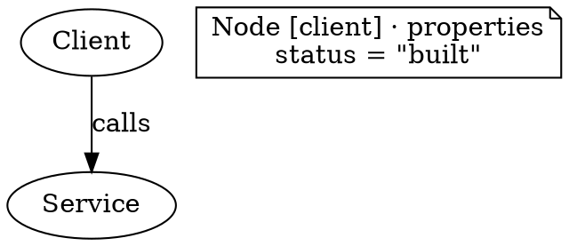

---
ddx:
  id: CONTRACT-087
  type: contract
  activity: design
  authoring:
    home: repo
  links:
    - id: FEAT-035
      kind: informed_by
    - id: FEAT-036
      kind: informed_by
    - id: CONTRACT-083
      kind: informed_by
    - id: CONTRACT-085
      kind: informed_by
    - id: CONTRACT-086
      kind: informed_by
    - id: visual.architecture
      kind: informed_by
---

# CONTRACT-087: Opt-in readable visual annotations

## Purpose

Version 1.0.0 design for explicitly selected profiles; implementation qualification
is recorded separately. Reconciled against merged main 3139590.
The owner requests complete meaning in at least one suitable target
for each of the 53 unchanged examples, with faithful previews of all 22 forms.
Readable annotations carry additional application/provenance meaning. Actual
native constructs still carry graph, state, timeline and chart meaning.

## Scope and Boundaries

Start with two explicit profiles: `umf.visual.dot.annotated/1` and
`umf.visual.lini.annotated/1`; their initial implementation capability records
declare mapping version 0.1.0. They target the frozen
visual 1.0.0 model first. Both model versions are registered on merged main:
1.0.0 remains default; generated 1.1.0 is explicit opt-in. A profile must declare
1.1.0 support before claiming stable field IDs/exact multiplicities; neither
generated public types nor registration alone establishes those mappings. Native engine versions remain independent.
No default/historical native profile or receipt changes interpretation.

Candidate annotation fields: question, takeaway, audience, source path/view/digest,
omissions; participant/node role/status/emphasis/evidence; group status/emphasis;
edge kind/why where
not represented natively; ordered walkthrough title/caption/focus/when/tag.
An owner-selected field registry defines exact paths/types per model version.
Unknown extension/envelope fields cannot become understood through this fallback.

Annotation values are visible native text, not hidden custom attributes, tooltip
only content, comments, a whole-source JSON blob or an image. DOT notes are
explicit annotation objects excluded from semantic node/edge counts. Lini uses
identified table cells. Captured source remains a recovery artifact, separately.

## Precedence and Compatibility

CONTRACT-083 and the selected registered model version own semantic validity;
this profile cannot admit otherwise-invalid values. CONTRACT-086 owns safe
admission, strict/report policy and independently derived source replay.
CONTRACT-085 owns catalog truthfulness. This opt-in contract adds representation
rules; it does not amend released defaults or authorize an
implicit model migration. New profile versions require explicit selection.

## Normative Surface

Additions are owned by root; portable source types own their exact implemented
shape. Luna helpers and native adapters use this seam:

```ts
type AnnotatedProfile = 'umf.visual.dot.annotated/1'
  | 'umf.visual.lini.annotated/1';
// Existing import/export options gain optional profile: AnnotatedProfile.
// Omitted profile selects existing behavior; unknown/mismatched profile refuses.
interface AnnotatedContext extends AdapterContext { profile?: AnnotatedProfile }
type AnnotationValue =
  | {kind:'string'; value:string}
  | {kind:'number'; value:number}
  | {kind:'boolean'; value:boolean}
  | {kind:'null'}
  | {kind:'array'; length:number}
  | {kind:'object'; members:string[]};
interface AnnotationEntry {
  id:string;                 // allocated native-safe property identity
  path:string;               // exact JSON Pointer; no display-name substitution
  name:string;               // exact final property name, or array index
  value:AnnotationValue;     // compilation input; not hidden native metadata
}
interface NativeLocator {
  id:string;                 // actual native note/cell identity
  slot:string;               // DOT label, Lini table cell, etc.
}
interface ProjectionCoverage {
  path:string;
  aspect:'value'|'presence'|'order'|'members'|'identity';
  representation:'native-concept'|'profile-annotation';
  native:NativeLocator[];
}
interface AnnotationReadback {
  entries:AnnotationEntry[];
  carriers:Record<string,NativeLocator[]>; // keyed by entry id
  diagnostics:InterchangeDiagnostic[];
}
// Shared portable helpers; do not depend on native engines or facade globals.
declare function compileAnnotations(document:Document, modelVersion:string,
  registeredPaths:readonly string[]):AnnotationEntry[];
// Format modules own emit/read, and must preserve all entries or refuse.
declare function emitAnnotations(entries:readonly AnnotationEntry[]): NativeCarrierStatements;
declare function readAnnotations(parsedNative:BoundedNativeAst): AnnotationReadback;
// Root owns comparison/coverage admission; adapter claims alone are insufficient.
declare function verifyCoverage(document:Document, parsed:AdapterParseResult,
  readback:AnnotationReadback): ProjectionCoverage[];
```

`NativeCarrierStatements` and `BoundedNativeAst` are format-local, not new public
generic ASTs. Existing result objects may add optional `profile` and `coverage`.
`coverage` is recomputed from admitted source/output, never trusted from caller
receipts. Add `annotation` identity kind only through the reviewed shared types;
do not disguise property carriers as semantic nodes, messages or groups.

The format renderer derives the visible owner heading from the registered
pointer and mapped owner identity; it is not a new shared helper field.
The helper names are candidateAnnotationPaths, compileAnnotations,
readJsonPointer, annotationIdForPath, encodeAnnotationValue,
decodeAnnotationValue and verifyAnnotationReadback. Root owns complete
native/profile reconstruction and audit admission beyond helper comparison.

Annotated receipts record the exact selected profile in `importOptions.profile`;
the profile identifier pins this wire version, and the retained native header
declares model 1.0.0. Mapping and native-engine versions remain separate
capability/evidence facts. Legacy receipts omit the profile selection and keep
their existing validation/replay behavior. Exact replay
still reparses with recorded interpretation and compares derived/current/baseline
documents; a forged coverage list cannot bypass that comparison.

## Examples

The following specimens define the proposed readable wire grammar.

Every owner-scoped block visibly identifies its owner and contains rows of exact
property name and typed value. Scalar tokens use JSON scalar spelling only:
quoted string, finite number, `true`, `false` or `null`. A native text edit
changes this visible scalar. No hidden scalar copy is authoritative.

Full paths/type descriptors live in native identity attributes or reversible
native IDs and are shown in the catalog inspector. Owner headings include an
unambiguous owner kind/identity; duplicate display labels never conflate owners.
A friendly label may supplement identity but cannot replace it. Exact scalar
property names stay visible, while repeated long pointer/type columns are avoided.

Containers use explicit visible `Length: N` or `Members: [...]` tokens
plus child rows, never nested value blobs. This preserves empty/absent arrays,
order, object presence and exact member names. Schema validation still rejects
null in a non-null field. Missing optional paths have no row; `""`, `[]`, `{}`,
`false`, `0` and null remain distinct. Names use JSON quoting when necessary.

### DOT compact carrier

The actual native note is an annotation object excluded from semantic node/edge
counts. Descriptor attributes carry only identity/path/type/profile; scalar values
occur only in the visible label. An owner can have one compact block with
addressable property rows; this one-row specimen keeps addressing simple:



The portable reader verifies the owner/name/token type against descriptors and
the registered model field. Values come from decoded native label text. A note
must not create an authored graph relation. Independent Graphviz JSON/SVG
readback verifies exact label/type/identity and visible values; native acceptance
alone does not qualify every string or edit. The ordinary profile does not
interpret these annotations.

### Lini compact carrier

Use native two-column tables with stable cell IDs. The heading names the owner;
the property cell names the field; the value cell contains the visible typed
token. A descriptor cell ID reversibly encodes exact path/type, or resolves
through the validated profile's native identity manifest. That manifest may hold
identity/path/type only, never a second scalar value or a whole source document.
The full-path identity encoding must be pinned before format implementation.

```lini
|table#umf_ann_node_client| "Node [client] · properties" { columns: 140, 260; } [
  |cell#ann_status_name| "status"; |cell#ann_status_value| "\"built\"";
]
```

Pinned Lini 1.1.0 table/cell compilation has been probed; the compact syntax must
also pass the durable native suite. Native slot identity, not text or position,
addresses each value. The visible token reader must preserve whitespace through
its quoted representation or refuse unsupported text. Never use hidden hints
or style/classes as the authoritative value. Edited values, missing/copied cells
and conflicting descriptors require actual readback tests.

### Legible complete output

Keep annotations adjacent to their owner where practical or in a clearly keyed
legend outside the main drawing. Group related fields under one owner heading;
do not repeat full pointers, provenance digests or owner headings per scalar.
Provide a focused diagram preview and a complete annotated view of the same
native artifact; the focused crop is not the complete semantic-support claim.
The complete downloadable source and annotated preview must expose every carrier.
Test longest real examples at useful zoom: no diagram/legend overlap, clipped
text, or metadata table that makes the diagram unreadable. Large complete views
may pan/zoom in their panel; the page must fit mobile width.

Use segment-aware JSON Pointers with normal `~0`/`~1` decoding. Paths cannot
address unregistered fields, escape their declared owner or write prototype
properties. Unknown fields retain normal incomplete/loss/refusal behavior.

## Coverage and Policy

Root grants coverage only after serializing, reading actual emitted native
carriers through portable bounded parsing, and comparing each recovered typed
value/presence/order against the input. This runs without native engines.
Independent native engines separately qualify that the format accepts and
visibly presents the same content; local self-roundtrip is insufficient proof.
For Graphviz visible-text checks, decode actual SVG text once through XML
entities. Its xdot JSON text operations can escape backslashes before quotes
differently; that serialization artifact is not a license to normalize source
values or replace the visible SVG witness with a portable self-roundtrip.

The first qualified subset also compares the complete parsed native AST with
re-emission from the recovered document. Attribute/property order may be
normalized; native objects, containment, presentation properties and statement
order cannot silently disappear. Unknown presentation edits therefore refuse,
even when semantic readback alone would succeed. This residual-content guard
does not establish native validity, legibility or faithful geometry; those
require independent native/render evidence for the declared form and subset.

Coverage for a scalar clears only that scalar's omission. A container's presence
does not cover descendants; all members/items require their own native or
annotation coverage. Container order/membership is checked against native
identities. No arbitrary parent prefix may suppress audit diagnostics.
Unknown paths or unsupported native constructs still report/refuse normally.

Known intrinsic semantics cannot be declared covered merely by an annotation:
chart numbers/axes, connectivity, direction, attachment, containment, message
order, state initial/final/transition parts and entity constraints need qualified
native/profile constructs that visibly embody those semantics. A value duplicated
in an annotation must agree with the intrinsic representation or import refuses.

Pure annotation edits may update registered scalar values after normal schema
validation. Changing Path/Name/Type, deleting/duplicating carriers, changing array
length/membership or identity descriptors is outside first edit support and
refuses atomically against a retained binding. A fresh standalone import may
admit a complete valid newly authored profile; it does not authenticate origin.
Native intrinsic edits and annotation edits must agree before publishing one
replacement document. Failure returns retained source and no partial result.

## Form Suitability

- DOT state profile is promising for both current state examples: explicit
  state identities and initial/final markers, attached directed transitions,
  readable typed event/guard/action parts, plus annotation metadata. It is an
  adapter-owned UML-style rendering profile, not generic DOT state semantics.
- DOT tree uses explicitly typed parent-to-child containment edges, distinct
  from authored flow edges. Nested containment uses native clusters; their
  descendant lists are transitive, so direct parent identity requires explicit
  descriptors and visible nesting. Stack layers require independently asserted
  band order; rank heuristics alone are insufficient.
- Mermaid stateDiagram-v2 has native state/transition/start/end meaning. Event,
  guard/action/path distinctions need a reviewed visible transition grammar and
  independent readback; the native parser exposes only a relation-title string.
- Mermaid lifelines do not satisfy ladder merely by carrying `form: ladder` in
  an annotation; CONTRACT-086 diagnoses that substitution. The separate DOT
  profile implements participant columns, ordinal directed rungs and exact
  call/return ordering. Native tests distinguish solid ladder rails from dashed
  lifelines and verify geometry, endpoints and message order. TD-094 governs
  this explicit rendering convention, without retroactively redefining vanilla
  Mermaid support.
- Lini native chart/table/grid probes are promising for metrics/comparisons/
  timelines. Preserve actual series/time/category/grid semantics; annotations
  handle additional provenance/status/format intent, not missing chart data.
  Percent scale interpretation, compact/currency/duration presentation, category
  IDs, event collisions and selected/low/high meanings require explicit proof.

## Catalog Contract

Keep existing `targets.dot/mermaid/lini` results and historical native baseline
accessible. Add a separate profile-variant collection and preferred release
choice, as an additive catalog extension under CONTRACT-085:

```ts
interface ProfileVariant {
  profileId:AnnotatedProfile; mappingVersion:string; modelVersion:string;
  format:InterchangeFormat;
  result:CatalogTarget; coverage:ProjectionCoverage[];
}
// Per item: profileVariants?: ProfileVariant[];
// preferredRelease?: {format:InterchangeFormat; profileId:string};
```

The selected variant must be strict, complete and independently native-backed.
UI labels it `Qualified annotation profile` and distinguishes annotation versus
intrinsic representation. It must never display annotated success as ordinary
vanilla-native success. Other target limitations and original source stay visible.

## Error Semantics

| Condition | Required result |
| --- | --- |
| Unknown/mismatched profile/model version | Refuse; preserve source |
| Duplicate native/property ID or reserved-name collision | Refuse, never merge by label |
| Visible descriptor conflicts with path/type identity attributes | Refuse |
| Missing carrier or unsupported structure edit against baseline | Atomic refusal |
| Invalid scalar escape/type/null/number, unsupported Unicode/control | Refuse without normalization |
| Annotation value conflicts with native diagram value | Refuse both competing changes |
| Unknown semantic field or unrepresented intrinsic construct | Existing loss/incomplete/refusal policy |
| Forged coverage/changed baseline/native text | Reparse and independently rederive; reject mismatch |

Allocate deterministic property IDs from a reserved namespace after checking all
native objects, groups, fields and annotation IDs. Native object identity is
never a display string. Reused/copy-pasted descriptors and conflicting paths
refuse. Use existing source byte/depth/line/cardinality bounds and safe JSON
admission; no dynamic path evaluation, native code or config execution.

## Verification Handoff

1. Root finalizes profile/options/receipt/coverage types and path ownership.
2. Luna annotation package owns new src/interchange/annotations/ plus unit tests.
3. DOT and Lini owners implement their carriers and new isolated tests; root
   alone changes facade allowlists, public entry points and catalog selection.
4. Prove ordinary native defaults and historical receipts unchanged. Add exact
   empty/false/zero/array/object presence, slash/tilde name, Unicode/escape and
   collision controls. Test native text edits, deleted/copied carriers and
   conflicting semantic/native edits in Bun and Chromium.
5. Native Graphviz JSON/SVG and pinned Lini WASM witnesses must verify actual
   text/identity/order, not merely successful compilation. Then compare complete
   reconstructed documents through public APIs and serialized retained replay.
6. No loss is cleared until per-field readback and native evidence pass. Root
   records selected-profile strict coverage for every unchanged example; Sol
   reviews intrinsic semantics and annotation claims separately.
